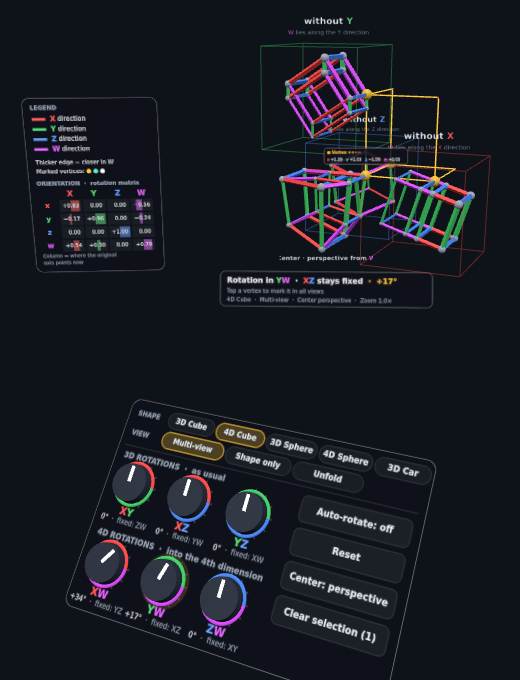
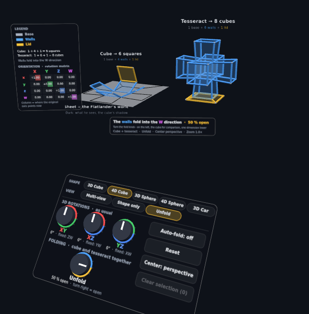

# Tesseract XR

[English](README.md) · **Deutsch**

Interaktive Darstellung der vierten Dimension für die **Meta Quest 3 im AR-Modus (Passthrough)**, gebaut mit WebXR und three.js. Man dreht 4D-Formen mit Drehknöpfen in den 6 Ebenen des 4D-Raums, sieht sie in einer **Rissansicht** wie auf einem Bauplan und kann den Tesseract wie einen Würfel **aufklappen**.

Version 4 · Stand Oktober 2026 · Live: https://tesseract-xr.okercode.de

Ein nicht-kommerzielles Projekt aus akademischem Interesse: Wie lässt sich die vierte Dimension anschaulich machen? Die Darstellungen dienen dem Lernen und Verstehen.



## Änderungen

| Version | Inhalt |
|---|---|
| 4 | Neue Form: Wurmloch (Einbettungsdiagramm) |
| 3 | Englische Sprachversion (automatisch nach Browsersprache, umschaltbar), neue Reihenfolge der Formen: 3D-Würfel, 4D-Würfel, 3D-Kugel, 4D-Kugel, 3D-Auto; three.js lokal ausgeliefert (keine Anfragen an Dritte), Impressum-/Datenschutz-Links, MIT-Lizenz |
| 2 | Formen-Auswahl (Tesseract, 3D-Würfel, 3D-Kugel, 4D-Kugel, Auto), Aufklapp-Modus (Würfel → Kreuz, Tesseract → Dalí-Kreuz), Kanten als 4-kantige Leisten, Favicon |
| 1 | Tesseract, Rissansicht, 6 Drehknöpfe, Ordnungslinien, Legende und Drehmatrix, Greifen und Zoomen |

---

## Starten

WebXR läuft nur über **HTTPS** (oder `localhost`). Ein Build-Schritt ist nicht nötig. Der ganze Ordner wird so ausgeliefert, wie er ist; three.js (Version 0.160.0) liegt unter `vendor/three/` und wird per Import-Map geladen, es gehen also keine Daten an fremde Server.

| Weg | Vorgehen |
|---|---|
| Lokal am PC testen | `python3 -m http.server 8000` im Projektordner, dann `http://localhost:8000` öffnen |
| Quest 3 | Ordner auf einen HTTPS-Webserver legen, Adresse im **Meta Quest Browser** öffnen, „Start AR“ antippen |
| Eigener Server (Plesk) | Plesk-Git-Erweiterung mit Deploy-Key und Webhook: jeder Push auf `main` wird automatisch ausgeliefert |
| Quest per USB, ohne Server | `adb reverse tcp:8000 tcp:8000`, dann auf der Brille `http://localhost:8000` öffnen (localhost gilt als sicher) |

Einfach die `index.html` per Doppelklick zu öffnen funktioniert nicht, weil ES-Module über `file://` blockiert werden.

**Sprache:** Deutsch bei deutschem Browser, sonst Englisch. Umschalten über `?lang=de` bzw. `?lang=en` in der Adresse oder über „DE · EN“ auf der Startseite (vor dem Start von AR). Die Wahl wird im Browser gespeichert.

---

## Was man sieht

Am Pult wählt man oben in der Kopfzeile **Form** und **Ansicht**. Nicht jede Kombination ist sinnvoll; ausgegraute Felder erklären in der Statuszeile, warum.

| Form | Rissansicht | nur Form | Aufklappen | Was man daran lernt |
|---|---|---|---|---|
| 3D-Würfel (bei w = 0) | ✓ | ✓ | ✓ | Ein 3D-Objekt ist im 4D-Raum flach: in „ohne X/Y/Z“ in Ruhe platt |
| 4D-Würfel (Tesseract) | ✓ | ✓ | ✓ | Grundform, Drehebenen, Würfel im Würfel |
| 3D-Kugel (bei w = 0) | ✓ | ✓ | – | wird bei XW zur Scheibe; nach 180° unverändert, weil sie ihr eigenes Spiegelbild ist |
| 4D-Kugel | ✓ | ✓ | – | ein Großkreis pro Drehebene: der Kreis der aktiven Ebene kreist in sich, der Kreis der festen Ebene steht still |
| 3D-Auto (bei w = 0) | ✓ | ✓ | – | **nach 180° in XW gespiegelt**: Lenkrad rechts, Kennzeichen spiegelverkehrt |
| Wurmloch | ✓ | ✓ | – | gekrümmter Raum als Einbettungsdiagramm: die Seitenansichten zeigen den bekannten Trichter, das perspektivische Zentrum beide Seiten als ineinanderliegende Schalen |

**Zum Wurmloch:** Es ist ein *Einbettungsdiagramm* eines Ellis-Wurmlochs. Ein gekrümmter 3D-Raum wird als Hyperfläche im 4D-Raum gezeichnet; jede Kugelschale mit Radius r liegt bei w = ±b·arcosh(r/b). W ist hier nur eine Hilfsdimension, die die Krümmung sichtbar macht, keine Richtung, in die man reisen könnte. Die beiden Blätter (türkis und orange) sind die beiden Seiten, verbunden am goldenen Schlund. In den Seitenansichten rückt W an die Stelle einer Raumachse, und die Schalen stapeln sich zum Trichter aus den Lehrbüchern.

### Kanten als Leisten

Kanten sind 4-kantige Leisten statt runder Rohre. Jede Leiste ist so gedreht, dass eine flache Seite vom Mittelpunkt ihrer Ansicht weg zeigt. Dadurch wirken die verzerrten Würfel wie Rahmen, und das Licht fällt auf jede Seite anders. Umschalten in `config.js`: `EDGE_STYLE = 'beam' | 'tube'`.

### Aufklappen



Links ein 3D-Würfel, der sich auf einem **Blatt Papier** zu 6 Quadraten aufklappt. Auf dem Blatt liegt sein **Schatten**: das, was ein Flachländer sieht. Rechts klappt sich der Tesseract genauso zu **8 Würfeln** auf (Dalí-Kreuz). Beide hängen am selben **Falt-Knopf**, der im Aufklapp-Modus die Reihe der 4D-Knöpfe ersetzt.

| Rolle | Würfel | Tesseract | Farbe |
|---|---|---|---|
| Boden | 1 Quadrat | 1 Würfel | Grau |
| Wände | 4 Quadrate | 6 Würfel | Blau |
| Deckel | 1, an der hinteren Wand | 1, an der unteren Wand | Gold |

Jede Wand dreht sich um 90° um die Fläche, die sie mit dem Boden teilt: beim Würfel in die Höhe, beim Tesseract in die W-Richtung. Beim Zuklappen klappt zuerst der Deckel hoch, dann die Wände. Zugeklappt sieht man den bekannten Würfel im Würfel; beim Würfel zeigt der Schatten dazu passend ein Quadrat im Quadrat. Beim Wechsel in den Aufklapp-Modus wird die 4D-Lage zurückgesetzt; die 3D-Knöpfe drehen nur das Dalí-Kreuz.

### Rissansicht (Standard)

Die Logik stammt aus der Dreitafelprojektion: **Jede Ansicht lässt eine Achse weg und liegt entlang genau dieser Achse versetzt.**

| Darstellung | Position | zeigt | Besonderheit |
|---|---|---|---|
| Zentrum | Mitte | X Y Z | umschaltbar: **perspektivisch** (Würfel im Würfel, 4D-Kamera auf der W-Achse) oder **orthogonal** („ohne W“) |
| ohne X | rechts | W Y Z | W liegt auf der X-Richtung |
| ohne Y | oben | X W Z | W liegt auf der Y-Richtung |
| ohne Z | hinten | X Y W | W liegt auf der Z-Richtung (zum Ansehen um den Aufbau herumgehen oder ihn drehen) |

Die Seitenansichten sind immer orthogonal. Bei 0° zeigt jede Ansicht einfach einen Würfel, denn die Kanten der fehlenden Achse fallen zu Punkten zusammen. Es ist wie beim Grundriss eines Würfels, auf dem die senkrechten Kanten unsichtbar sind.

### Farben

| Element | Bedeutung |
|---|---|
| Rot / Grün / Blau / Magenta | Kante parallel zu X / Y / Z / W (je 8 Stück) |
| Kantendicke | näher in W = dicker |
| Gold / Türkis / Weiß | markierte Ecken 1–3 |
| Magenta-Bögen | Viertelkreise, die die W-Koordinate zwischen Seitenansichten übertragen |
| Rahmenfarbe einer Seitenansicht | die Achse, die dort fehlt |

### Ordnungslinien

Tippt man eine Ecke an, wird sie in allen Ansichten markiert und verbunden:
- **Zentrum ↔ Seitenansicht:** gerade Linie. Im orthogonalen Zentrum ist sie achsparallel, weil beide Ansichten zwei Koordinaten teilen.
- **Seitenansicht ↔ Seitenansicht:** gerade Linie bis zur Versatz-Ebene, dann ein **Viertelkreis** und wieder gerade. Das ist die klassische Konstruktion aus dem technischen Zeichnen.

### Info-Elemente

| Element | Ort | Inhalt |
|---|---|---|
| Statuszeile | unter dem Aufbau | aktive Drehebene, welche Ebene fest bleibt, Winkel, worauf der Strahl zeigt, Modus und Zoom |
| Legende + Drehmatrix | linkes Handgelenk (erscheint, wenn man den Controller zum Gesicht dreht), am Desktop links | Farbbedeutungen und die 4×4-Matrix; Spalte = wohin die ursprüngliche Achse jetzt zeigt |
| Ecken-Tooltip | über markierter Ecke | aktuelle Koordinaten (x, y, z, w) |

Die Knopfwinkel zeigen, wie weit an diesem Knopf gedreht wurde. Die **tatsächliche Lage beschreibt nur die Matrix**, weil 4D-Drehungen (wie 3D-Drehungen) von der Reihenfolge abhängen.

---

## Bedienung

### Quest 3 – Controller

| Aktion | Eingabe |
|---|---|
| Ebene drehen | Strahl auf einen Knopf, Trigger oder Grip halten, **Handgelenk drehen** (wie ein Drehregler); alternativ Stick links/rechts |
| Aufklappen | wie oben am Falt-Knopf; eine halbe Umdrehung nach rechts = ganz auf |
| Form / Ansicht wählen | Strahl auf ein Feld der Kopfzeile + Trigger |
| Schaltfläche | Strahl drauf + Trigger |
| Ecke markieren / Markierung entfernen | Strahl auf Ecke + Trigger |
| Aufbau verschieben und drehen | Trigger oder Grip im leeren Raum halten und Hand bewegen |
| Näher holen / wegschieben | dabei Stick vor/zurück |
| Zoomen (0,3× – 5×) | mit **beiden** Händen greifen, Hände auseinander/zusammen |
| Auto-Rotation an/aus (im Aufklapp-Modus: Auto-Falten) | A oder X |
| Auswahl löschen | B |
| Info-Panel anheften/lösen | Y |
| Aufbau neu vor sich platzieren | linken Stick drücken |
| Stärke der 4D-Perspektive | rechter Stick links/rechts (ohne zu greifen) |

**Hand-Tracking:** Pinch entspricht dem Trigger. Drehen am Knopf funktioniert ebenfalls über das Handgelenk.

Wichtig: Wenn man den Aufbau greift und dreht, ändert sich nur der **Blickwinkel**. Matrix und Seitenansichten bleiben gleich. Die Knöpfe XY/XZ/YZ dagegen drehen den Tesseract **in seinem 4D-Raum**.

### Desktop (zum Entwickeln)

Knopf mit der Maus ziehen, Ecke klicken, Hintergrund ziehen zum Umsehen, Mausrad zum Zoomen.

| Taste | Funktion |
|---|---|
| S | nächste Form |
| V | nächste Ansicht (Rissansicht → nur Form → Aufklappen) |
| 1–6 | aktive Ebene: XY, XZ, XW, YZ, YW, ZW |
| ← → | aktive Ebene um 5° drehen, im Aufklapp-Modus 5 % falten |
| Leertaste | Auto-Rotation / Auto-Falten |
| P | Zentrum perspektivisch/orthogonal |
| R | zurücksetzen |
| C | Auswahl löschen |

In der Browser-Konsole steht `window.__tesseract` (state, views, setup, scene …) zum Experimentieren bereit, z. B. `__tesseract.state.turn(2, Math.PI/4)`.

---

## Aufbau des Codes

```
index.html              Seite, Import-Map, Favicons, Desktop-Hilfe, Impressum-/Datenschutz-Links
vendor/three/           three.js 0.160.0 (Modul, ARButton, OrbitControls, LICENSE)
favicon.svg/.ico, apple-touch-icon.png
src/
  config.js             alle Konstanten: Farben, Ebenen, Maße, Geschwindigkeiten, Kantenstil
  i18n.js               Übersetzungen (de, en) und Spracherkennung
  main.js               Szene, Platzierung, Verdrahtung der Module, Render-Schleife
  core/
    math4d.js           4D-Drehung, Projektionen, Zahlenformat (ohne Three.js)
    state.js            AppState: Form, Ansicht, Matrix, Knopfwinkel, Faltgrad, Auswahl, Meldungen
  shapes/
    common.js           Beschreibung des Formen-Formats, Kreis-Helfer
    tesseract.js        16 Ecken, 32 Kanten (Farbe nach Achse)
    cube3d.js           3D-Würfel bei w = 0
    spheres.js          3D-Kugel und 4D-Kugel als Kreisnetz
    car.js              Cabrio aus Grundformen (Flächenmodell, Kennzeichen mit Textur)
    wormhole.js         Wurmloch als Einbettungsdiagramm (4D-Katenoid)
    index.js            Liste aller Formen
  render/
    batches.js          instanzierte Leisten/Rohre, Kugeln, dynamische Vierecke
    views.js            Zentrum + 3 Seitenansichten für die gewählte Form, Ecken-Picking
    meshProjector.js    Flächenmodelle (Auto) durch Drehung und Projektion schicken
    links.js            Ordnungslinien und Viertelkreisbögen
    unfold.js           Aufklappen: Würfel mit Blatt und Schatten, Tesseract als Dalí-Kreuz
  ui/
    canvasPanel.js      Canvas-Textur als Fläche/Sprite, Text-Helfer, UI-Farben
    pult.js             Bedienpult mit 6 Knöpfen und Schaltflächen
    statusLine.js       Statuszeile
    infoPanel.js        Legende + Drehmatrix
    vertexLabels.js     Koordinaten-Tooltips
  input/
    interaction.js      Zeiger (XR-Controller, Hände, Maus), Treffer, Gamepad-Tasten
    manipulator.js      Aufbau greifen, verschieben, zoomen
```

### Datenfluss pro Frame

```
Interaction.update   Eingaben lesen → state ändern (turn, toggle…)
AppState.update      Auto-Rotation, Projektions-Überblendung, Matrix nachorthonormieren
ViewSet.update       Ecken drehen (M·v) und projizieren → Kanten/Ecken-Batches
Links.update         Ordnungslinien für markierte Ecken
UI-Module            zeichnen ihre Canvas nur neu, wenn sich state.version ändert (gedrosselt)
renderer.render
```

### Mathematik in Kürze

- **Orientierung:** 4×4-Matrix `M` (zeilenweise im Array). Ecke `v` wird zu `M·v`.
- **Drehung in Ebene (a, b) um θ:** Zeilen a und b von `M` werden gemischt (`M ← G·M`). Die Drehung bezieht sich also immer auf die festen Achsen der Ansicht, nicht auf die schon gedrehten.
- **Feste Ebene:** Bei Drehung in (a, b) bleibt die Ebene der beiden anderen Achsen komplett unverändert (XW ↔ YZ, YW ↔ XZ, ZW ↔ XY).
- **Perspektive:** Kamera bei w = d, Faktor `d / (d − w)`. Die Überblendung zur orthogonalen Projektion läuft mit `1 + t·(Faktor − 1)`.
- **Seitenansicht ohne a:** Koordinate a wird durch w ersetzt, dann um `SIDE_OFFSET` entlang a versetzt.

---

## Weiterentwickeln

| Vorhaben | Wo ansetzen |
|---|---|
| Farben, Größen, Abstände | nur `config.js` |
| Texte ändern, neue Sprache | `i18n.js`: Block mit denselben Schlüsseln anlegen; fehlende Schlüssel fallen auf Englisch zurück |
| Neue Schaltfläche | `Pult.buttons` (Beschriftung) + `Pult.action` + Methode in `AppState` |
| Neue Darstellung (z. B. Schnitt-Modus) | neues Modul in `render/` nach dem Muster von `views.js`, in `main.js` einhängen, Moduswert in `state.viewMode` |
| Neue Form (z. B. 16-Zeller, 24-Zeller, Würfelpyramide) | Datei in `src/shapes/` nach dem Format in `common.js`, in `shapes/index.js` eintragen. Sie erscheint automatisch am Pult. |
| Weitere Eingabe | `Interaction.press/release/update`; Zeiger liefern nur einen Strahl und ein Quaternion |

### Geplante Ausbaustufen

1. **Geführte Tour:** 6 Kapitel als Voreinstellungen mit je einer Aufgabe in der Statuszeile
2. Hinweise bei besonderen Momenten (z. B. bei 90°: „X und W haben getauscht“), Zellen einzeln anwählen
3. Schnitt-Modus (3D-Querschnitt bei w = c, ideal für die 4D-Kugel), Tesseract direkt mit den Händen drehen
4. Weitere Formen: Würfelpyramide, Duoprisma, 16-Zeller, 24-Zeller

### Bekannte Grenzen

- Die Ansicht „ohne Z“ liegt hinter dem Zentrum. Von vorn ist sie verdeckt, dafür muss man den Kopf seitlich bewegen oder den Aufbau drehen.
- Die Linienstärken sind auf eine Betrachtung aus etwa 50–80 cm abgestimmt. Bei starkem Zoom-out werden sie dünn.
- Die Knopfwinkel werden auf ±180° gefaltet angezeigt.
- Im Aufklapp-Modus gibt es keine Rissansicht und keine Eckenauswahl.
- Der Sprachwechsel lädt die Seite neu, also vor dem Start von AR umschalten.

Die Kommentare im Code sind auf Deutsch.

---

## Lizenz

[MIT](LICENSE) © 2026 Simon Schliecker. three.js 0.160.0 liegt unter `vendor/three/` mit eigener MIT-Lizenz bei; die App lädt nichts von fremden Servern.
